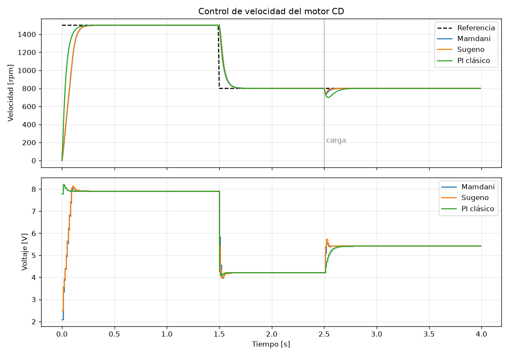
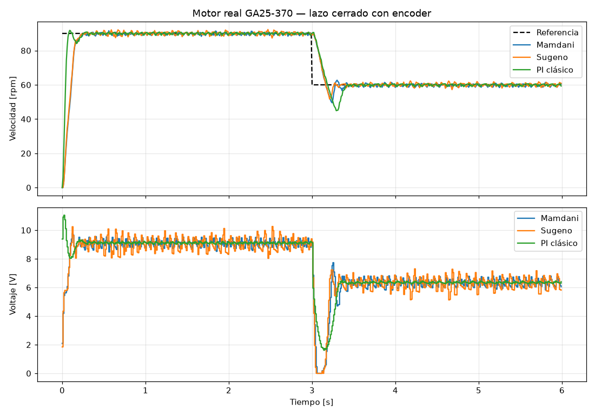

# Controlador difuso para motor CD

Control de **velocidad** de un motor CD con lógica difusa.

- **Fase A (U1):** sistema de inferencia difusa (Mamdani y Sugeno) y simulación del motor en Python.
- **Fase B (U2):** el mismo controlador corriendo en un **ESP32-S3**: en modo HIL y en lazo cerrado real con un motor GA25-370 con encoder.

## Estructura

```
fase_a/
  fuzzy.py            Motor de inferencia difusa hecho a mano (sin librerías)
  controlador.py      Reglas, ganancias y controlador difuso PI incremental (+ PI clásico)
  motor_dc.py         Modelo físico del motor (RK4)
  simular.py          Lazo cerrado, métricas y pruebas de robustez
  superficie.py       Funciones de pertenencia, superficies y ejemplo paso a paso
  test_controlador.py Pruebas automáticas (python -m unittest)
  resultados/         Gráficas generadas
fase_b/
  esp32_fuzzy/esp32_fuzzy.ino   Firmware (Arduino IDE)
  interfaz_web.py     Abre la interfaz web (interfaz_web/index.html + control.js)
  interfaz.py         Interfaz de escritorio (Tkinter) para simulación, HIL y motor real
  calibrar_encoder.py Cuenta vueltas para calibrar el encoder
  puerto.py           Abre el puerto sin dejar a la ESP32-S3 en modo de descarga
  hil_planta.py       HIL desde la terminal
  prueba_motor.py     Identificación del motor real (velocidad máxima y tau)
GUIA_DEFENSA.md       Preguntas probables y respuestas (¡todos deben leerla!)
USO_IA.md             Declaración de uso de IA
```

## Cómo correrlo

```bash
pip install -r requirements.txt
cd fase_a
python -m unittest -v      # 10 pruebas
python simular.py          # tabla de métricas + gráficas
python superficie.py       # superficies + inferencia paso a paso
```

## Diseño del controlador

**Tipo:** difuso PI incremental, con 2 entradas y 1 salida.

| Señal | Definición | Escala (normaliza a [-1, 1]) |
|---|---|---|
| e  | ref − rpm | Ke = 1 / (0.20·RPM_MAX) |
| de | e_k − e_(k−1) | Kde = 1 / (0.066·RPM_MAX) |
| du | salida del FIS | Kdu = 2.5 V por periodo |

u_k = sat(u_(k−1) + du_k) con límite de ±12 V y periodo Ts = 10 ms.

- **Conjuntos:** 5 triángulos por variable (NG, NP, Z, PP, PG) con 50 % de traslape. Los de los extremos son hombros.
- **Reglas:** tabla de 5×5 (MacVicar-Whelan) con una diagonal de equilibrio en `Z`.
- **Mamdani:** AND = min, implicación = min, agregación = max, defuzzificación por centroide.
- **Sugeno (orden 0):** las salidas son singletons en −1, −0.5, 0, 0.5 y 1, y se combinan con un promedio ponderado.

## Resultados de simulación (modelo nominal)

| | Sobrepaso | t. subida | t. establ. (2 %) | Error final | Caída con carga |
|---|---|---|---|---|---|
| Mamdani | 0 % | 0.12 s | 0.19 s | 0 rpm | 65 rpm |
| Sugeno  | 0 % | 0.11 s | 0.19 s | 0 rpm | 54 rpm |
| PI clásico | 0 % | 0.08 s | 0.15 s | 0 rpm | 101 rpm |

**Robustez, sin volver a sintonizar:**

| Cambio en el motor | Sobrepaso Mamdani | Sobrepaso Sugeno | Sobrepaso PI |
|---|---|---|---|
| J ×2 | 0.6 % | 0.6 % | 8.8 % |
| R +50 % | 0 % | 0 % | 3.6 % |
| K −20 % | 0 % | 0 % | 5.4 % |

**Conclusión honesta:** con el modelo nominal el PI es más rápido. Los difusos rechazan mejor la carga y casi no cambian cuando varían los parámetros del motor. Con ruido de 15 rpm, Sugeno reacciona más que Mamdani, porque cerca de cero su superficie es más inclinada.



## Fase B: ESP32-S3 + motor con encoder

Hardware: **ESP32-S3-WROOM-1** (DevKitC-1), puente H **L298N**, motor **GA25-370 de 12 V y 130 rpm** con encoder Hall y fuente de 12 V.

Hay dos formas de probar el controlador en el ESP32:

| | HIL | Motor real (lazo cerrado) |
|---|---|---|
| ¿Quién mide la velocidad? | Un modelo en la PC | El encoder del motor |
| ¿Dónde corre el controlador? | ESP32 | ESP32 |
| ¿Qué demuestra? | Que el código en C hace lo mismo que el de Python | Que el controlador difuso controla un motor de verdad |

### Conexiones

> La ESP32-S3 **no tiene GPIO 25 a 33** (los usa la memoria flash), por eso los pines son distintos a los de un ESP32 normal.
> El canal A iba en GPIO15, pero en nuestra placa ese pin se queda en bajo; con el comando `d` lo diagnosticamos y lo pasamos al GPIO7.

| ESP32-S3 | Destino |
|---|---|
| GPIO4 | ENA del L298N (quitar el jumper de ENA) |
| GPIO5 / GPIO6 | IN1 / IN2 del L298N |
| GPIO7 / GPIO16 | Encoder A (C1) / B (C2) |
| 3V3 | VCC del encoder |
| GND | GND del encoder y GND del L298N |
| (LED integrado, GPIO48) | Muestra la pertenencia del error |

Cables del GA25-370 (colores típicos; confírmenlos con lo impreso en la placita del motor):

| Color | Función | Va a |
|---|---|---|
| Rojo | Motor + (M1) | OUT1 del L298N |
| Blanco | Motor − (M2) | OUT2 del L298N |
| Azul | VCC del encoder | 3V3 del ESP32-S3 |
| Negro | GND del encoder | GND del ESP32-S3 |
| Amarillo | Canal A (C1) | GPIO7 |
| Verde | Canal B (C2) | GPIO16 |

### LED de colores: la pertenencia en vivo

El LED integrado muestra la **etiqueta difusa dominante del error** (e = referencia − velocidad). Cambia de color cada vez que cambia la etiqueta con mayor grado de pertenencia:

| Color | Etiqueta | Qué significa |
|---|---|---|
| Rojo | NG | Muy por **encima** de la referencia |
| Amarillo | NP | Un poco por encima |
| Verde | Z | En la referencia |
| Cian | PP | Un poco por debajo |
| Azul | PG | Muy por **debajo** de la referencia |
| Apagado | — | Motor parado |

Al arrancar se ve azul → cian → verde. Si frenan el eje con los dedos, pasa de verde a cian o azul y regresa a verde cuando el controlador compensa.

### Pasos

1. **Subir el firmware.** Abran `fase_b/esp32_fuzzy/esp32_fuzzy.ino` en Arduino IDE, elijan la placa **"ESP32S3 Dev Module"** y súbanlo. Conecten el cable USB al puerto marcado **UART/COM** de la placa. Si usan el otro (**USB**), activen *Herramientas → USB CDC On Boot → Enabled*.
2. **Calibrar el encoder** con `python fase_b/calibrar_encoder.py --puerto COM6 --voltaje 4` (el motor gira solo y ustedes cuentan 10 vueltas), o a mano con el Monitor Serie a 115200 y "Nueva línea":
   - escriban `q` para silenciar los datos;
   - escriban `c` y anoten las cuentas;
   - giren el eje de salida **10 vueltas a mano**, marcando una referencia en el eje;
   - escriban `c` otra vez. Cuentas por vuelta = (segunda − primera) / 10.
   - Debe salir cerca de **1980**. Si sale otro número, pónganlo en `CUENTAS_POR_VUELTA` y vuelvan a subir el firmware. Si sale negativo al girar en el sentido de avance, pongan `INVERTIR_ENCODER = true`.
3. **Medir el motor** (cerrar el Monitor Serie):
   ```bash
   python fase_b/prueba_motor.py identificar --puerto COM7 --voltaje 12
   ```
   Pongan el número que imprime en `RPM_MAX_REAL`. Midan también desde qué voltaje empieza a girar (con `v1`, `v2`… en el Monitor Serie) y pónganlo en `ZONA_MUERTA_V`.
4. **Controlar el motor real:** en la interfaz, modo **"Motor real"** → *Ejecutar* o *Comparar todos los métodos*. Durante la prueba, en el segundo indicado en "Entra la carga", frenen el eje con los dedos.

Comandos por el Monitor Serie: `r90` (referencia en rpm), `m`/`s`/`i` (Mamdani/Sugeno/PI), `v6` (6 V en lazo abierto), `p` (paro), `c` (cuentas del encoder), `d` (diagnóstico de los canales A y B), `z6` (zona muerta en vivo), `q` (silenciar datos), `h` (modo HIL).

**Puerto en Python:** la S3 se reinicia en modo de descarga si se abre el puerto de la forma normal. Todos los scripts usan `puerto.abrir_esp32()`, que lo evita.

### Lo que medimos en nuestro motor

| Dato | Valor | Cómo |
|---|---|---|
| Cuentas por vuelta | 1982 (reducción 1:45) | `calibrar_encoder.py`, 10 vueltas |
| Sentido del encoder | Invertido (`INVERTIR_ENCODER = true`) | Con voltaje positivo contaba en negativo |
| Velocidad máxima | 113 rpm con 12 V | Escalón de 12 V (el L298N se come ~2 V) |
| Zona muerta | Arranca a 6–8 V, se detiene a ~5 V; se usa 6.0 V | Rampa de voltaje sin compensación |
| Constante de tiempo | ~50 ms | Escalón de 12 V (el modelo simulado tenía 40 ms) |

### Resultados en el motor real (90 → 60 rpm, sin carga)

| Controlador | Sobrepaso | t. subida | Error final | Mínimo al bajar a 60 | Ruido |
|---|---|---|---|---|---|
| Mamdani | 1.8 % | 0.12 s | 0.2 rpm | ~50 rpm | 0.6 rpm |
| Sugeno | 2.6 % | 0.12 s | 0.1 rpm | ~50 rpm | 0.9 rpm |
| PI clásico | 2.0 % | 0.04 s | 0.2 rpm | ~45 rpm | 0.5 rpm |



- Los tres siguen la referencia con menos de 0.3 rpm de error.
- Al bajar de velocidad, el voltaje no puede cambiar de signo: el motor queda libre y lo frena su fricción. Antes, el voltaje negativo más la compensación de zona muerta daba un frenazo de ~6 V que hundía la velocidad a 38 rpm.
- Sugeno mueve más el voltaje que Mamdani con el ruido del encoder, igual que en la simulación: cerca de cero su superficie es más inclinada.

**Protecciones:** si el voltaje está al máximo 1 s y el motor no gira, o el encoder cuenta al revés, el ESP32 apaga el motor y dice la causa. En HIL, si la PC deja de mandar datos 300 ms, apaga el motor.

### Interfaz web (recomendada)

```bash
python fase_b/interfaz_web.py
```

Abre la página en el navegador (**Chrome o Edge**; Firefox no puede usar el puerto USB). Tiene todo lo de la interfaz de escritorio y además el panel **Inferencia difusa en vivo**:

- los triángulos de pertenencia de **e** y **de** con un cursor que se mueve y el porcentaje de cada etiqueta;
- la tabla de las **25 reglas**, que se encienden según su fuerza de disparo (del color de su salida);
- la **salida**: el área recortada de Mamdani con su centroide, o los pesos de Sugeno con el promedio ponderado;
- la etiqueta dominante del error, del mismo color que el LED de la ESP32-S3.
- **Velocidad en palabras:** un deslizador de 0 al 95 % de las rpm máximas (en el motor real, 0 a 107 rpm) con las etiquetas *Parado · Lento · Medio · Rápido · Muy rápido* marcadas debajo (0, 22, 44, 66 y 88 %). Al moverlo, el motor arranca y sigue la referencia en vivo; se describen en palabras el objetivo y la velocidad medida ("Va 61 % Rápido y 39 % Muy rápido"). En 0 el motor queda libre (0 V). En Simulación y HIL hay una casilla de carga simulada. *Detener motor* termina.
- **Reproducción en cámara lenta:** al terminar una corrida se puede reproducir a 1×, 0.5×, 0.25× o 0.1×, o arrastrar la barra de tiempo; una línea en las gráficas marca el instante que se muestra. En vivo, el dibujo se suaviza (0.12 s) para que no brinque con el ruido del encoder; el control no se ve afectado.

La lógica está en `interfaz_web/control.js` (traducción directa de `fase_a`; da las mismas métricas que Python) y la página en `interfaz_web/index.html`. No necesita internet.

### Interfaz de escritorio (Tkinter)

```bash
python fase_b/interfaz.py
```

- **Conexión:** elegir el puerto y presionar *Conectar*. Antes, cierren el Monitor Serie de Arduino.
- **Modo:** *Simulación* (solo PC), *HIL* (ESP32 + motor simulado) o *Motor real* (lazo cerrado con el encoder). Al cambiar a *Motor real*, el escenario pasa a 90 → 60 rpm.
- **Controlador:** Mamdani, Sugeno o PI clásico (el PI solo es para comparar).
- **Escenario:** las dos referencias, cuándo cambia, cuándo entra la carga y cuánta carga. En *Motor real* la carga se aplica a mano.
- **Comparar todos los métodos:** corre los tres uno tras otro, encimados en la misma gráfica, con su tabla de métricas. En *Motor real* espera a que el motor se detenga entre corridas.
- **Motor manual:** un deslizador de −12 a 12 V para mover el motor en lazo abierto.
- **Guardar resultados:** gráfica (PNG) y datos (CSV) en `fase_b/resultados/`.

HIL desde la terminal (sin interfaz): `python fase_b/hil_planta.py --puerto COM7 --metodo mamdani`.

## Equipo

| Integrante | Módulo principal |
|---|---|
| 1 | `fuzzy.py`, `superficie.py` |
| 2 | `motor_dc.py`, `simular.py`, pruebas |
| 3 | Firmware ESP32 y electrónica |
| 4 | `hil_planta.py`, `prueba_motor.py`, documentación |

Aunque cada quien tiene su módulo, **todos** deben poder explicar todo (ver `GUIA_DEFENSA.md`).
