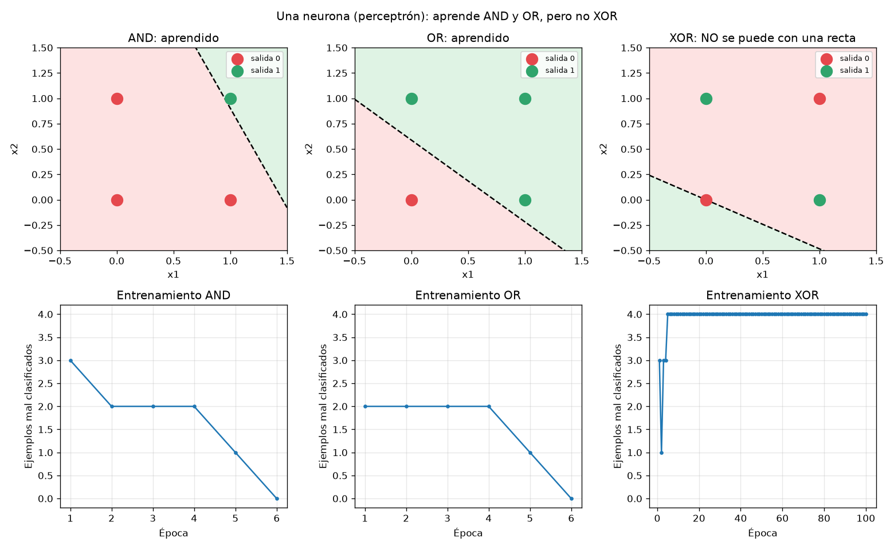
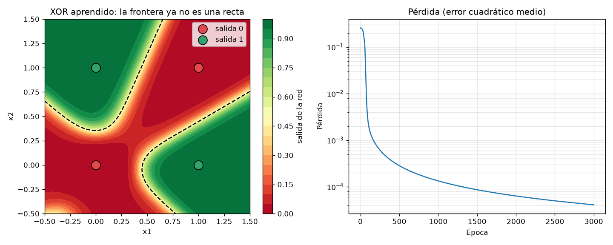
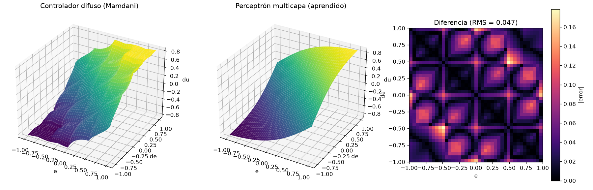
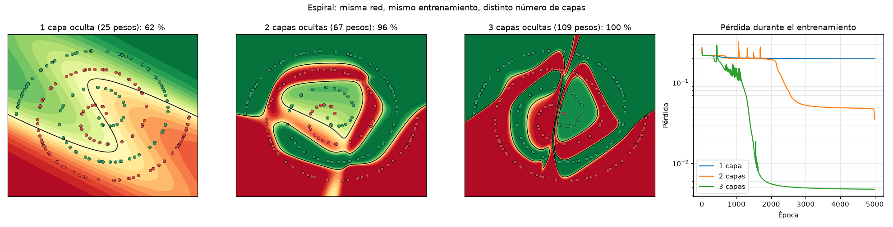

# Neurona y perceptrón multicapa (desde cero, con numpy)

Sin librerías de redes neuronales: todo (propagación, retropropagación, entrenamiento)
está escrito a mano para que se pueda explicar línea por línea.

| Archivo | Qué hace |
|---|---|
| `neurona_pelona.py` | **Una neurona pelona**: Python puro, aprende AND e imprime cada corrección paso a paso. |
| `perceptron_capas.py` | **Perceptrón multicapa con 1, 2 y 3 capas ocultas** (6 neuronas c/u) comparados en XOR y en una espiral. |
| `neurona.py` | **Una neurona** (perceptrón de Rosenblatt). Aprende AND y OR; **no puede** con XOR. |
| `mlp.py` | **Perceptrón multicapa** con retropropagación. Aprende XOR y además **imita al controlador difuso** de la práctica del motor (`../motor_cd_difuso`). |
| `test_redes.py` | 5 pruebas automáticas (incluye verificar el gradiente numéricamente). |
| `resultados/` | Gráficas generadas. |

## Cómo correrlo

```bash
pip install numpy matplotlib
cd neurona_mlp
python neurona_pelona.py   # una neurona pelona aprendiendo AND, paso a paso
python perceptron_capas.py # perceptrón multicapa con 1, 2 y 3 capas ocultas (~8 s)
python neurona.py          # una neurona: AND, OR, XOR
python mlp.py              # MLP: XOR e imitación del difuso (~7 s)
python -m unittest -v      # pruebas
```

## Resultados

| Experimento | Resultado |
|---|---|
| Neurona pelona – AND | aprende en 7 épocas (w1 = 0.2, w2 = 0.2, b = −0.3) |
| MLP 1 / 2 / 3 capas ocultas – espiral | 62 % / 95.5 % / 99.5 % (ver sección "1, 2 y 3 capas") |
| Neurona – AND | converge en 6 épocas, 100 % |
| Neurona – OR | converge en 6 épocas, 100 % |
| Neurona – XOR | **no converge** (máximo 75 %, típico 25–50 %) |
| MLP 2-4-1 – XOR | 100 %, pérdida 0.26 → 0.00004 en 3000 épocas |
| MLP 2-12-12-1 – imitar Mamdani | error RMS 0.047 en 500 puntos nuevos (salida de −0.83 a 0.83, ≈ 3 %) |





---

## 1. La neurona (perceptrón)

```
z = w1·x1 + w2·x2 + b          (suma ponderada)
y = escalón(z) = 1 si z ≥ 0, si no 0
```

- **Pesos `w`**: cuánto importa cada entrada. **Sesgo `b`**: mueve el umbral.
- **Regla de aprendizaje**: por cada ejemplo, `error = y_deseada − y`;
  `w ← w + tasa·error·x`, `b ← b + tasa·error`. Si acierta, el error es 0 y no cambia nada.
- **Época** = una pasada por todos los ejemplos.
- `w1·x1 + w2·x2 + b = 0` es una **recta**: la neurona divide el plano en dos.
  Por eso solo aprende problemas **linealmente separables** (AND, OR).
  En XOR, (0,1) y (1,0) dan 1 y (0,0) y (1,1) dan 0: ninguna recta los separa.
  Esto lo demostraron Minsky y Papert (1969).

## 2. Perceptrón multicapa (MLP)

Varias neuronas organizadas en capas:

```
entradas (2) → capa oculta (tanh) → … → salida (sigmoide o lineal)
a = tanh(a_anterior · W + b)
```

- Cada neurona oculta traza **su propia recta**. La siguiente capa **combina** esas rectas,
  así la frontera puede ser curva (ver `mlp_xor.png`).
- Activaciones:
  - **tanh** en la capa oculta: no lineal y derivable. Sin una función no lineal, varias capas equivalen a una sola.
  - **sigmoide** en la salida para clasificar (0 a 1).
  - **lineal** para regresión (imitar el difuso).
- El escalón no sirve en el MLP porque su derivada es 0 y no deja calcular gradientes.

### Entrenamiento: retropropagación (backpropagation)

1. **Hacia adelante**: se calcula la salida y la pérdida `L = promedio((y − y_deseada)²)`.
2. **Hacia atrás**, con la regla de la cadena se obtiene `dL/dW` de cada capa:
   - en la salida: `δ = 2(y − y_d)/N` (multiplicado por `y(1−y)` si la salida es sigmoide)
   - `dL/dW = a_anteriorᵀ · δ`, `dL/db = Σ δ`
   - capa anterior: `δ ← (δ · Wᵀ) · (1 − a²)`, donde `1 − a²` es la derivada de tanh
3. **Descenso de gradiente con momento**: `v ← 0.9·v − tasa·gradiente`, `W ← W + v`.
   El momento es como una "inercia": acelera en las bajadas largas y amortigua el zigzag.

La prueba `test_gradientes_coinciden_con_derivada_numerica` mueve cada peso ±1e-6
y compara con lo que da la retropropagación. Coinciden hasta 6 decimales, lo que
demuestra que las derivadas están bien.

### 1, 2 y 3 capas ocultas (`perceptron_capas.py`)

Mismas 6 neuronas por capa, misma tasa (0.3) y 5000 épocas; solo cambia el número de capas.

| Capas ocultas | Pesos | XOR | Espiral (200 puntos) |
|---|---|---|---|
| 1 | 25 | 100 % (50 épocas) | 62 % – no puede |
| 2 | 67 | 100 % (64 épocas) | 95.5 % |
| 3 | 109 | 100 % (64 épocas) | 99.5 % (aprende en ~1500 épocas) |

- **Problema fácil (XOR):** con una capa basta. Agregar capas no ayuda, solo añade pesos.
- **Problema difícil (espiral):** cada capa combina las formas de la anterior (rectas → curvas →
  figuras más complejas), así que más capas logran fronteras más enredadas.
- **Pero más capas no siempre es mejor:** el entrenamiento es más inestable (picos en la curva
  de pérdida), tarda más por época y depende más de los pesos iniciales.



### Experimento 2: la red aprende al controlador difuso

- Se toman 441 puntos (malla de 21×21) de la superficie `du = FIS(e, de)` del controlador
  Mamdani de la práctica del motor.
- Con esos puntos se entrena una red 2-12-12-1.
- Luego se prueba con 500 puntos al azar que **nunca vio**. Esto se llama **generalización**.
- Error ≈ 3 %: la red reproduce la forma general (la "rampa" del PI difuso),
  pero **suaviza** las ondulaciones pequeñas que produce el centroide de Mamdani.
- Ésta es la idea de los sistemas **neurodifusos** (como ANFIS): combinar las reglas
  difusas (entendibles) con el aprendizaje de las redes neuronales.

## Preguntas típicas para la defensa

- **¿Qué es el sesgo?** Un peso extra con entrada fija 1. Permite que la recta no tenga que pasar por el origen.
- **¿Por qué una neurona no aprende XOR?** No es linealmente separable y una neurona solo traza una recta.
- **¿Qué agrega la capa oculta?** Varias rectas combinadas forman fronteras no lineales.
  Por el teorema de aproximación universal, con suficientes neuronas un MLP aproxima cualquier función continua.
- **¿Qué es la tasa de aprendizaje?** El tamaño del paso. Si es muy grande, diverge u oscila; si es muy chica, aprende lento.
- **¿Qué es una época?** Una pasada completa por todos los datos de entrenamiento.
- **¿Por qué los pesos iniciales son aleatorios?** Si todos empiezan iguales, todas las neuronas aprenden lo mismo (simetría).
  Se usa la inicialización Xavier (`varianza = 1/n_entradas`) para que tanh no se sature.
- **¿Qué es la pérdida?** Una medida de qué tan mal lo hace la red (aquí, el error cuadrático medio). Entrenar = minimizarla.
- **¿Diferencia entre la regla del perceptrón y backprop?** El perceptrón solo corrige su propio error.
  Backprop reparte la culpa del error de la salida hacia las capas ocultas usando derivadas.
- **¿Qué es sobreajuste?** Cuando la red memoriza los datos de entrenamiento y falla en datos nuevos.
  Por eso se mide el error en puntos que no usó para entrenar.
